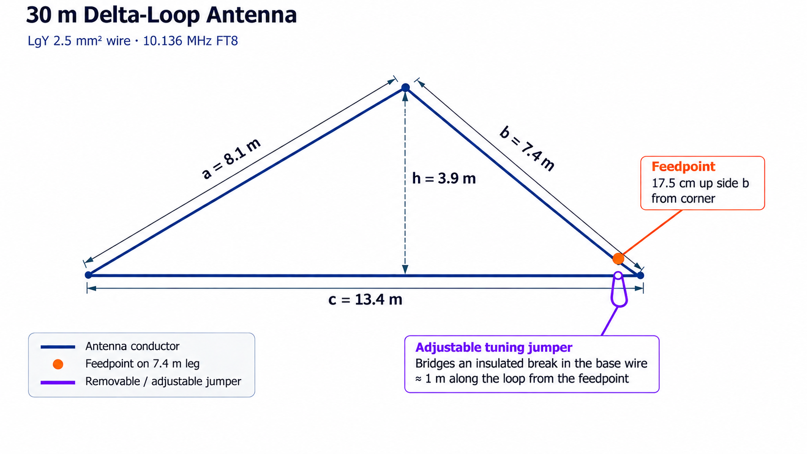
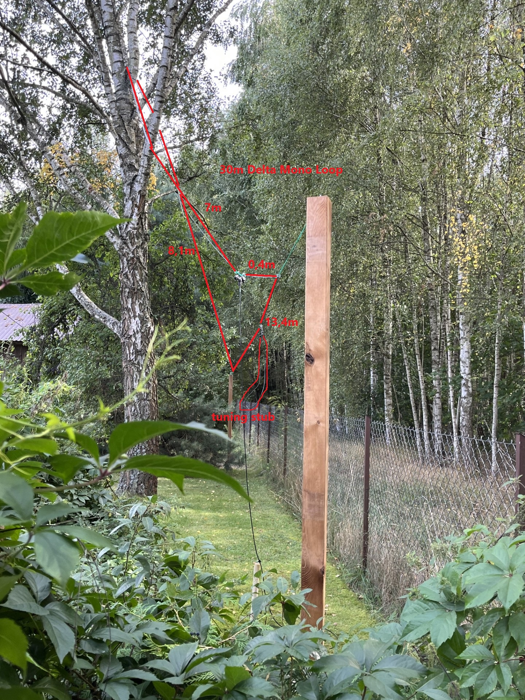

# Vertically Plarized Delta Loop for 30m band

A full wave loop is, as the words imply, a continuous loop of wire or other conductor approximately one wavelength long, usually with the two ends of the loop connected to the feedline [1].
For a full-wave triangular (delta-loop) antenna with the apex pointing up and the horizontal base at the bottom, the feedpoint for predominantly vertical polarization is close to the bottom corner (see chapter below for more precise feedpoint positioning).

## Calculation of Total Antenna Wire Length
For a delta-loop antenna constructed from **LgY 2.5 mm² PVC-insulated stranded copper wire**, a velocity factor of **approximately 1.0** may be assumed for preliminary free-space wavelength calculations. This is a simplifying approximation, not a measured velocity factor for the insulated wire.

The target operating frequency is **10.136 MHz**, the FT8 frequency on the **30-metre amateur radio band**.

### Given parameters

- Speed of light in vacuum:

  $$
  c = 299\,792\,458\ \mathrm{m/s}
  $$

- Operating frequency:

  $$
  f = 10.136\ \mathrm{MHz} = 10\,136\,000\ \mathrm{Hz}
  $$

### Wavelength calculation

The free-space wavelength is calculated as:

$$
\lambda = \frac{c}{f}
$$

Substituting the values:

$$
\lambda = \frac{299\,792\,458}{10\,136\,000} \approx 29.577\ \mathrm{m}
$$

### Estimated loop perimeter

For a full-wave delta-loop antenna, the total wire length (loop perimeter) is **approximately one free-space wavelength**:

$$
\boxed{L \approx \lambda \approx 29.58\ \mathrm{m}}
$$

This is an initial geometrical estimate, **not a guarantee of resonance**. The resonant perimeter can differ because of PVC insulation, wire diameter, triangle geometry, installation height, and nearby objects.

## Antenna Feedpoint Position
For a full-wave triangular (delta-loop) antenna with the apex pointing up and the horizontal base at the bottom, the feedpoint for predominantly vertical polarization is close to the one of the antenna bottom corners.

The usual starting rule of placing the feedpoint is ¼ of the total loop perimeter  from the apex (i.e. total length of wire used to build the antenna not just one of its sloping sides!).

A full-wave delta loop often presents approximately 100–115 Ω when fed for vertical polarization, but published antenna models also show values around 50 Ω for certain triangle geometries.

It is recommended to initially connect the antenna to 50 Ω coax such as RG-58 preferably using a 1:1 current choke at the feedpoint and measure its impedance with a NanoVNA.
If the measured resistance is around 100 Ω at resonance, a quarter-wave 75 Ω coaxial matching section described in [2] is an option. If it is close to 50 Ω, direct feeding can work well.

## Construction

It is sensible to start with **slightly more wire than the calculated length**, for example **31 m**, and then adjust the loop after installation. Use an **antenna analyser** or **vector network analyser (VNA)** to locate the desired resonance near **10.136 MHz**. If the measurements show that the antenna is electrically too long, trim the wire gradually. It is not recommended to cut the wire directly to the theoretical value without first measuring the installed antenna.

As an alternative, and to simplify the tuning process, a **tuning jumper** may be introduced as proposed in [3]. In this particular design, the tuning jumper is part of the **base wire** of the antenna. If a jumper is used, it is reasonable to start with a wire length of about **29.6 m**, because the total perimeter can then be increased easily by adjusting the jumper length. The design described here includes such a tuning jumper.

Changing the antenna dimensions slightly during the tuning process should **not significantly affect the feedpoint impedance**.

## Chosen antenna dimensions

Due to practical limitations, it was not possible to construct the antenna as an equilateral triangle. Instead, the following dimensions were chosen:

| Dimension | Length |
|---|---:|
| Base \(c\) | 13.4 m |
| Sloping side \(a\) | 8.1 m |
| Sloping side \(b\) | 7.4 m |
| Height \(h\) | 3.9 m |
| Total perimeter | 28.9 m |

For predominantly **vertical polarization**, the usual starting rule is to place the feedpoint at **one quarter of the total loop perimeter measured from the apex**:

$$
\frac{28.9}{4} = 7.225\ \text{m}
$$

## Feedpoint location

If the feedpoint is placed on the **8.1 m sloping side**, then:

$$
8.1 - 7.225 = \boxed{0.875\ \text{m}}
$$

So the feedpoint is located **87.5 cm up the wire from the bottom corner**.

Alternatively, if the feedpoint is placed on the **7.4 m sloping side**, then:

$$
7.4 - 7.225 = \boxed{0.175\ \text{m}}
$$

That places the feedpoint only **17.5 cm from the bottom corner** - location chosen in described implementation was 0.4m (for no particular reasons).

The **tuning jumper length** in the described design was approximately **1 m**.

## Diagram

*Conceptual diagram, not to scale.*

## Discussion of Performance

## References
[1] Practical Antennas, Theory of Full Wave Loops, https://practicalantennas.com/theory/loop/full-wave/

[2] Build a 75 ohm 1/4 Wave Matching Transformer – Q82.uk – Antenna Resources by Steve G0UIH – ex Vortex Antenna Systems, https://q82.uk/75ohm-matching-transformer

[3] 40m Delta Mono-Loop by DJ0IP, https://www.dj0ip.de/my-favorite-antennas/my-favorite-40m/